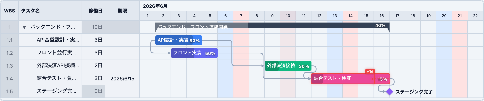
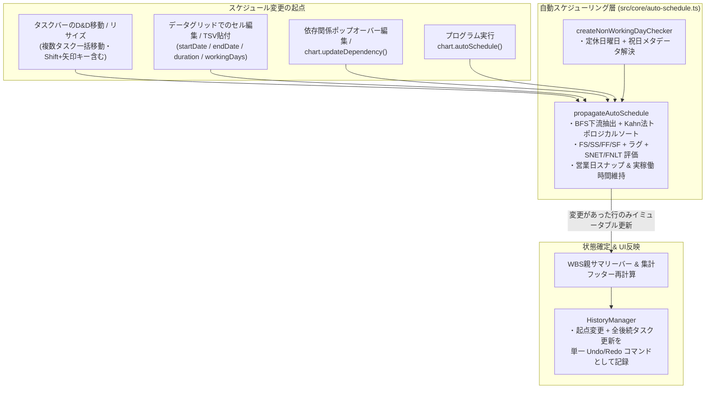
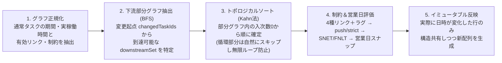
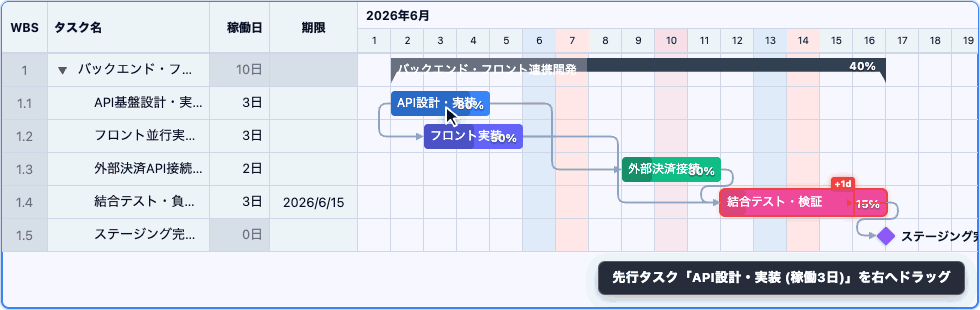
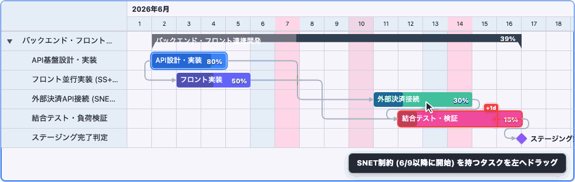
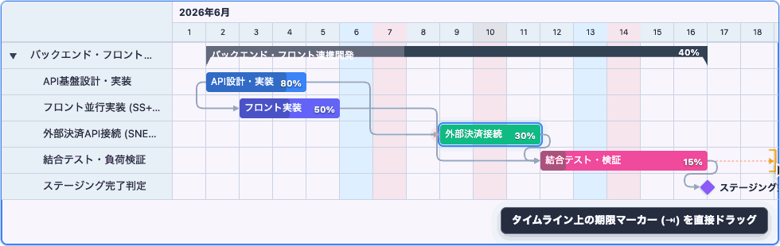

## はじめに

ガントチャートライブラリを自作・導入した際、「タイムライン上でバーをドラッグでき、タスク間に矢印（依存関係線）を引ける」ところまでは比較的スムーズに辿り着けます。

しかし、実際のプロジェクト管理で使い始めると、すぐに **「手作業でのリスケジュール地獄」** に直面します。

- 先行タスクが2日遅れたとき、後続に連なる20件のタスクを1つずつマウスでずらすのが辛い
- 単純に同じ日数だけ後ろへずらすと、**土日・祝日や自社定休日を跨いだときに「実稼働日数」が減ってしまう**
- 「先行タスクの開始2日後から並行着手したい（SS＋ラグ）」「部材納品日の6月10日より前には着手できない（SNET制約）」「目標デッドラインを超過したら一目でわかるようにしたい」といった実務ルールを表現できない

個人開発しているフレームワーク非依存・外部ランタイム依存ゼロ（`lit` ピア依存のみ）・MITライセンスの Web Components 製ガントチャートライブラリ **「[@mogura/moguchart-core](https://github.com/hiro-murakami/moguchart-core)」** では、v1.6.0 から最新 **v1.10.0** にかけて、これらを包括的に解決する **「自動スケジューリングエンジン」**、**「スケジュール制約・デッドライン機構」**、および **「依存関係編集ポップオーバー ＆ 更新API」** を実装しました。

https://github.com/hiro-murakami/moguchart-core

本記事では、自動スケジューリング周りの **実践的な API・コード例** と、裏側で動く **トポロジカルソート・営業日期間伸縮・制約クランプのアルゴリズムとUX設計** を解説します。

まずはブラウザ上で実際に触れるデモサイトもぜひお試しください！

https://moguchart-core.vercel.app

:::note info
**moguchart-core / MoguChart の関連記事はこちら**

- **コアライブラリの全体紹介**: [フレームワークに縛られないガントチャートを作った — Web Components製「moguchart-core」の紹介](https://qiita.com/hiroyuki_m/items/0e4859951a9f652c26c3)
- **マルチカラムデータグリッド編（ペア記事）**: [Web Components製ガントチャート「moguchart-core」にスプレッドシート風マルチカラムデータグリッドを実装した話](https://qiita.com/hiroyuki_m/items/940db6eaa92d54398407)
- **Webアプリ正式リリース＆最新機能**: [【祝 v1.0】無料でここまで動く！WBS・サマリー自動集計に対応したWebガントチャート「MoguChart」を正式リリースしました](https://qiita.com/hiroyuki_m/items/47f635a93c5e9d831b5a)
:::

---

## 全体フロー：あらゆる編集操作から単一トランザクションで連鎖更新

`moguchart-core` の自動スケジューリングは、タイムライン上のバー操作だけでなく、キーボード移動やデータグリッドでの日付・期間・稼働日編集とも完全に連動します。

コアとなる計算処理は DOM に一切依存しない純粋関数モジュール **`src/core/auto-schedule.ts`** として切り出されており、計算結果の反映から WBS サマリー再集計、Undo / Redo 履歴への記録までが**1つのアトミックなコマンド**として処理されます。



もし1つのタスクを動かして後続15件が連鎖移動した際、履歴スタックに16個の個別コマンドが積まれてしまうと、元に戻すために16回 `Cmd+Z` を連打する羽目になります。`moguchart-core` では連鎖更新の前後スナップショットを**単一トランザクションとして記録**するため、どれだけ大規模な玉突き移動が起きても **1回の `Cmd+Z` で全タスクが一括で元の位置へ戻ります**。

---

## 1. 拡張依存関係・営業日・制約・デッドラインの実践コード

`task.dependencies` は、従来のシンプルなタスクID文字列 `'t-1'`（標準の `FS`・ラグ0として解釈）と、詳細な `GanttDependencyLink` オブジェクトを混在できる**完全後方互換な設計**になっています。

以下に、4種依存関係・日本の祝日を含む営業日計算・スケジュール制約（`SNET`）・デッドライン（`deadline`）を組み合わせた実践コードを示します。

```typescript
import '@mogura/moguchart-core'
import type { GanttChartElement, GanttChartOption, GanttRow } from '@mogura/moguchart-core'
import JapaneseHolidays from 'japanese-holidays'

const rows: GanttRow[] = [
  {
    id: 'r-1',
    name: 'API設計・実装',
    tasks: [
      {
        id: 'api',
        name: 'API設計・実装',
        start: new Date('2026-06-01T00:00:00'),
        end: new Date('2026-06-05T00:00:00'), // 4稼働日
      },
    ],
  },
  {
    id: 'r-2',
    name: 'フロントエンド実装',
    tasks: [
      {
        id: 'fe',
        name: 'フロントエンド実装',
        start: new Date('2026-06-03T00:00:00'),
        end: new Date('2026-06-09T00:00:00'),
        // API開始の2営業日後から並行着手 (Start-to-Start + ラグ2日 = 2880分)
        dependencies: [{ taskId: 'api', type: 'SS', lag: 2 * 1440 }],
        // スケジュール制約: 6月4日以降にしか開始できない (Start No Earlier Than)
        constraintType: 'SNET',
        constraintDate: new Date('2026-06-04T00:00:00'),
      },
    ],
  },
  {
    id: 'r-3',
    name: '結合テスト',
    tasks: [
      {
        id: 'test',
        name: '結合テスト',
        start: new Date('2026-06-09T00:00:00'),
        end: new Date('2026-06-12T00:00:00'),
        // APIとフロントエンドの両方が完了してから開始 (文字列IDとも混在可能)
        dependencies: ['api', { taskId: 'fe', type: 'FS', lag: 0 }],
        // デッドライン（期限マーカー）：超過すると赤枠＋「+Xd」バッジで警告
        deadline: new Date('2026-06-15T00:00:00'),
      },
    ],
  },
]

const option: GanttChartOption = {
  calendar: {
    start: new Date('2026-06-01'),
    end: new Date('2026-06-30'),
    pxPerDay: 48,
    // 営業日ベース（定休日曜日＋祝日を除外して稼働日計算・自動スケジューリング）
    calendarMode: 'weekends-holidays',
    nonWorkingDays: [0, 6],          // 日曜・土曜を定休日（例: 火・水定休なら [2, 3]）
    preserveWorkingDaysOnDrag: true, // 手動ドラッグ時も休日を跨いだら実稼働日数を維持
    isHoliday: (date) => {
      const holidayName = JapaneseHolidays.isHoliday(date)
      if (holidayName) {
        // boolean だけでなく休日名・個別背景色のメタデータ返却にも対応
        return { name: holidayName, color: 'rgba(239, 68, 68, 0.08)' }
      }
      return false
    },
  },
  dependency: {
    autoSchedule: true,        // 操作時に後続タスクを自動カスケード更新
    scheduleMode: 'push-only', // 'push-only'（逆転時のみ押し出し）| 'strict'（常時厳密追従）
    respectMovable: true,      // movable: 'none' でロックされたタスクは移動対象から除外
    enableEditPopover: true,   // ダブルクリックや編集ボタンで種別・ラグ編集ポップオーバーを表示 (v1.10.0)
    showEditButton: true,      // 接続線選択時に線上に編集（鉛筆）ボタンを表示 (v1.10.0)
  },
  constraint: {
    enabled: true,
    showDragGuide: true,       // ドラッグ中に SNET/FNLT の侵入禁止シェードを表示
    clampOnDrop: true,         // 禁止領域へドロップしても自動的に制約境界へクランプ
  },
  deadline: {
    enabled: true,
    editable: true,            // タイムライン上の「⇥」マーカーを直接ドラッグして期限変更可能
    highlightOverdue: true,
    showOverdueBadge: true,
  },
}

const chart = document.querySelector<GanttChartElement>('gantt-chart')!
chart.rows = rows
chart.option = option
```

### 手動実行 API ＆ 純粋関数のスタンドアロン利用

常時自動連動（`autoSchedule: true`）を OFF にしておき、ユーザーのボタン押下時やサーバーサイド（Node.js）のバッチ処理で同じ計算エンジンを呼び出すことも可能です。

```typescript
import { propagateAutoSchedule } from '@mogura/moguchart-core'

// パターンA: チャートインスタンスのメソッドから実行（Undo/Redo履歴にも自動記録）
const updatedIds = chart.autoSchedule(['api'], { mode: 'strict' })

// 依存関係の種別・ラグをプログラムから更新（autoSchedule有効時は後続タスクも自動再計算＆Undo記録）
chart.updateDependency('api', 'fe', { type: 'SS', lagDays: 3 })

// パターンB: 純粋関数としてデータ配列を直接計算（DOM非依存）
const result = propagateAutoSchedule(rows, ['api'], {
  mode: 'push-only',
  calendarMode: 'weekends-holidays',
  nonWorkingDays: [0, 6],
})
if (result.hasChanges) {
  console.log('更新されたタスクID:', result.updatedTaskIds)
}
```

---

## 2. トポロジカルカスケード計算のアルゴリズム

依存グラフの日程伝播を単純な深さ優先の再帰関数で書くと、主に2つの問題が起きます。

1. **合流依存での重複計算と順序逆転**: `A → B`, `A → C`, `B → D`, `C → D` のようなダイヤモンド型グラフで、`B` と `C` の両方が確定する前に `D` を計算してしまい、無駄な再計算が発生する。
2. **循環依存による無限ループ**: インポートデータ等に万が一 `A → B → A` のようなループが含まれていた場合、スタックオーバーフローでタブがクラッシュする。

`propagateAutoSchedule()` では、**BFS（幅優先探索）による下流抽出** と **Kahn法によるトポロジカルソート** を組み合わせた5段階パイプラインにより、計算量 `O(V + E)` で安全かつ一発で確定順序を導出しています。



### 4種類の依存関係（FS / SS / FF / SF）と接続端点の自動判定

トポロジカル順に各タスクを評価する際、すべての先行タスクから要求される開始時刻（`computeRequiredStartMs`）の最大値（`Math.max`）を求めます。

| タイプ                      | 意味                | 接続端点（コネクタ）        | 後続タスクの要求開始時刻（カレンダー基準の基本式） |
| :-------------------------- | :------------------ | :-------------------------- | :------------------------------------------------- |
| **`FS`** (Finish-to-Start)  | 先行終了 → 後続開始 | 右端 `end` → 左端 `start`   | `predEndMs + lagMs`                                |
| **`SS`** (Start-to-Start)   | 先行開始 → 後続開始 | 左端 `start` → 左端 `start` | `predStartMs + lagMs`                              |
| **`FF`** (Finish-to-Finish) | 先行終了 → 後続終了 | 右端 `end` → 右端 `end`     | `predEndMs + lagMs - succDurationMs`               |
| **`SF`** (Start-to-Finish)  | 先行開始 → 後続終了 | 左端 `start` → 右端 `end`   | `predStartMs + lagMs - succDurationMs`             |

ここで `lag` は分単位で正の値（遅延ラグ）だけでなく **負の値（前倒しリード：たとえば先行終了の1日前からオーバーラップ着手する `FS` + `lag: -1440`）** も指定可能です。

UI 上でもタスクバーの左右両端にコネクタ丸印を備えており、**「左端から左端へドラッグして繋げば `SS`」「右端から右端へ繋げば `FF`」** と `endpointsToDependencyType()` が自動判定し、直角折れ線（`orthogonal`）やベジェ曲線（`curve`）のSVGパスも正しい端点からルーティングされます。

### 接続線上でのダイレクト編集ポップオーバー ＆ 独自ダイアログ連携（v1.10.0）

一度引いた接続線の種別やラグ期間を後から微調整したい場面に向け、v1.10.0 では **組み込み依存関係編集ポップオーバー** と **線上編集ボタン** を実装しました。

- **その場で種別・ラグを変更**: 接続線をダブルクリックするか、接続線をクリック選択した際に削除（`×`）ボタンと並んで表示される **編集（鉛筆）ボタン** を押すとポップオーバーが開き、種別（`FS` / `SS` / `FF` / `SF`）やラグ／リード値（日・時間・月などの表示スケールに応じた単位へ自動適応）を変更・削除できます。確定時には `dependency-update` イベントが発火し、後続タスクの自動スケジューリング結果（`affectedTasks`）も含めて1件の `'dependency-update'` コマンドとして Undo / Redo に記録されます。
- **ホストアプリ独自ダイアログへの柔軟な委譲**: 本番アプリ側でリッチな専用モーダルを使いたい場合は、`enableEditPopover: false` と `showEditButton: true` を組み合わせる（またはキャンセル可能な `dependency-edit` イベントで `e.preventDefault()` を呼ぶ）ことで、線上の鉛筆ボタン UI だけを活かしつつ独自ダイアログを起動できます（ダイアログ終了時は `chart.clearDependencySelection()` で選択ハイライトを解除可能）。

### `push-only` と `strict` の違い

先行タスクからの要求開始時刻 `maxRequiredStartMs` が算出された後、`scheduleMode` によって挙動を選択できます。

- **`'push-only'`（デフォルト）**: `Math.max(currentStartMs, maxRequiredStartMs)` を適用します。先行タスクが遅れて依存制約に違反（逆転）した場合のみ後続タスクを後ろへ押し出し、余裕期間（フロート）がある場合は元の予定を維持します。
- **`'strict'`（厳密追従）**: 常に `maxRequiredStartMs` を適用します。先行タスクを前倒しした際、後続タスクもラグを保ったまま自動で前倒し追従させたいケースに最適です。

---

## 3. 営業日・祝日・カスタム定休日を跨ぐ「実稼働日数維持」ロジック

自動スケジューリングの実装で最も奥が深いのが **営業日（稼働日）ベースの期間伸縮** です。

たとえば、木曜・金曜の **2営業日（暦日2日間）** のタスクが、先行タスクの遅延によって **金曜開始** に押し出されたケースを考えます。

```
[変更前] 水曜 ──▶ [木曜][金曜] (暦日2日 / 稼働2日)
[誤った移動]       金曜 ──▶ [金曜][土曜(休)] (暦日2日だが、稼働1日に減ってしまう！)
[正しい移動]       金曜 ──▶ [金曜][土曜(休)][日曜(休)][月曜] (暦日4日 / 稼働2日を維持！)
```

単純に `end = start + duration` と平行移動させると、土日にかかった分だけ作業日数が削られてしまいます。`auto-schedule.ts` では以下の3つのプリミティブ関数を組み合わせることで、この問題を正確に解決しています。

1. **`computeWorkingDurationMs(startMs, endMs, isNonWorkingDay)`**:
   計算開始前に、各タスクが現在持っている「休日を除いた純粋な実稼働時間（ミリ秒）」を日単位セグメントの積算で抽出する（万が一元タスクが休日上のみに置かれていた場合は期間 `0` 潰れを防ぐため暦日期間へフォールバック）。
2. **`snapToWorkingStartMs(ms, isNonWorkingDay)`**:
   着地予定の開始時刻が定休日曜日（`nonWorkingDays`）または祝日（`isHoliday`）に該当する場合、翌営業日の `00:00:00` へスナップさせる。
3. **`addWorkingTimeMs(anchorMs, deltaMs, isNonWorkingDay)`**:
   正方向（`deltaMs > 0`：ラグ加算や開始日からの終了日算出）だけでなく、**負方向（`deltaMs < 0`：`FF` / `SF` リンクや後述する `FNLT` 制約で終了時刻から開始時刻を逆算するケース）** においても、非営業日をスキップしながら営業時間を加減算する。

さらに、この稼働日判定基盤を `option.calendar` に統合したことで、自動スケジューリングだけでなく **「手動ドラッグ移動時の稼働日数維持（`preserveWorkingDaysOnDrag`）」「ツールチップでの稼働日数併記」「Excel エクスポート時の休日セル着色」** まで、すべて同じカスタム定休日・祝日ルールで一貫して動作します。



---

## 4. スケジュール制約（`SNET` / `FNLT`）とデッドラインの役割分担（v1.9.0）

実務の工程表では、タスク間の前後関係とは別に「外部要因による日付条件」が頻繁に登場します。v1.9.0 では、性質の異なる2つの機能を導入しました。

| 機能                                 | プロパティ                                                   | 役割・スケジューリングへの影響                                                                                                      |
| :----------------------------------- | :----------------------------------------------------------- | :---------------------------------------------------------------------------------------------------------------------------------- |
| **スケジュール制約**<br>(Constraint) | `constraintType: 'SNET' \| 'FNLT'`<br>`constraintDate: Date` | **「絶対に越えられない境界（ハード制約）」**。<br>自動スケジューリングでも手動ドラッグでも境界内に強制拘束・クランプする。          |
| **デッドライン**<br>(Deadline)       | `deadline: Date`                                             | **「目標期限と遅延の可視化（ソフト指標）」**。<br>スケジュール自体は止めず、期限を超過した際に赤枠＋超過バッジ（`+3d`）で警告する。 |

### ① `propagateAutoSchedule` への制約統合

- **`SNET`（Start No Earlier Than / 指定日以降に開始）**: 先行タスクが前倒しになっても、`Math.max(rawTargetStartMs, snetStartMs)` により制約日（営業日モード時は翌営業日スナップ後）より前へは移動させません。
- **`FNLT`（Finish No Later Than / 指定日までに終了）**: 終了日が制約日を越えない最大開始時刻 `fnltMaxStartMs`（営業日モード時は `addWorkingTimeMs(constraintDateMs, -effectiveDurationMs)` で逆算）を求め、`Math.min(rawTargetStartMs, fnltMaxStartMs)` で上限を抑えます。そしてその制約適用後の日時が、さらに下流の後続タスクへとカスケード伝播します。

### ② ドラッグ中に「侵入禁止エリア」が見える UX（`constraint-drag-guide.ts`）

制約付きタスクを手動でドラッグした際、ドロップした瞬間に無言で押し戻されると「なぜ動かないのか？バグか？」とユーザーを混乱させてしまいます。

そこで `constraint-drag-guide.ts` では、タスクバーをドラッグ・リサイズしている最中にリアルタイムで視覚フィードバックを描画します。

- 制約境界の外側（侵入禁止期間）に **斜線ハッチングシェード** と **破線境界ライン**、ビューポート追従の **ラベルバッジ（例: `⇥ 2026/06/04 以降に開始 (SNET)`）** を表示。
- ドラッグ中のバーが禁止領域へ入った瞬間、シェードとバッジが **`⚠` 付きの赤色警告表示** に変化。
- ドロップ確定時（および `Shift + 矢印キー` での移動時）には、`autoSchedule` が OFF の環境であっても `clampMovedTaskDates()` / `clampResizedTaskDates()` が自動的に制約境界へピタリとクランプ（補正）します。



### ③ タイムライン上で直接ドラッグできるデッドライン（`⇥`）

一方、「スケジュール自体は実態通り後ろへ押し出しつつ、客先納期に対して何日遅れているかを可視化したい」という場面では `task.deadline` を使います。

- タイムライン上に期限マーカー（`⇥`）とタスク終端からの破線コネクタを描画し、`task.end > task.deadline` となった瞬間にタスクバーの赤枠ハイライトと超過日数バッジ（`+2d`）を自動表示します。
- 期限マーカー自体をマウスで左右にドラッグして直感的に期限日を変更でき、`task-deadline-change` イベントおよび Undo / Redo（`'task-deadline'` コマンド）にも完全対応しています。



---

## 5. Vue 3 / React でのイベント連携例

公式ラッパー `@mogura/moguchart-vue`（または `@mogura/moguchart-react`）を使ったイベントハンドリングと手動スケジューリング呼び出しの例です。

```vue
<script setup lang="ts">
import { ref } from 'vue'
import { GanttChart, type GanttChartInstance } from '@mogura/moguchart-vue'
import type {
  DependencyUpdateEventDetail,
  GanttChartOption,
  GanttRow,
  TaskDeadlineChangeEventDetail,
} from '@mogura/moguchart-core'

const props = defineProps<{
  initialRows: GanttRow[]
  option: GanttChartOption
}>()

const chartRef = ref<GanttChartInstance | null>(null)
const rows = ref<GanttRow[]>(props.initialRows)

// 自動スケジューリング連鎖更新を含む全行の変更を一括同期
const handleRowsChange = (detail: { rows: GanttRow[] }) => {
  rows.value = detail.rows
}

// 依存関係ポップオーバーや updateDependency() による種別・ラグ変更を検知 (v1.10.0)
const handleDependencyUpdate = (detail: DependencyUpdateEventDetail) => {
  console.log(
    `依存更新: ${detail.sourceTaskId} -> ${detail.targetTaskId}`,
    detail.dependency,
    `連鎖更新タスク数: ${detail.affectedTasks?.length ?? 0}`,
  )
}

// デッドラインマーカーのドラッグ変更を検知
const handleDeadlineChange = (detail: TaskDeadlineChangeEventDetail) => {
  console.log(`タスク ${detail.task.id} の期限を変更:`, detail.originalDeadline, '->', detail.deadline)
}

// ボタンから全依存関係を厳密追従モードで一括再計算
const runStrictSchedule = () => {
  const updatedIds = chartRef.value?.autoSchedule(undefined, { mode: 'strict' })
  console.log('再計算されたタスク数:', updatedIds?.length ?? 0)
}
</script>

<template>
  <div>
    <div class="toolbar">
      <button @click="chartRef?.undo()">元に戻す (Undo)</button>
      <button @click="chartRef?.redo()">やり直す (Redo)</button>
      <button @click="runStrictSchedule">後続タスクを一括整列</button>
    </div>

    <GanttChart
      ref="chartRef"
      :rows="rows"
      :option="option"
      style="height: 600px; width: 100%"
      @rows-change="handleRowsChange"
      @dependency-update="handleDependencyUpdate"
      @task-deadline-change="handleDeadlineChange"
    />
  </div>
</template>
```

---

## まとめ

`@mogura/moguchart-core`（最新 v1.10.0：`lit` ピア依存のみの外部ランタイム依存ゼロ・約 98KB gzipped・Node16 / NodeNext 厳密 ESM 対応）の自動スケジューリングエンジンは、単なる「矢印の描画」にとどまらず、実務のプロジェクト管理で求められる複雑な制約条件をシンプルかつ高速に処理できるよう設計しました。

- `FS` / `SS` / `FF` / `SF` ＋ 分単位ラグ・リードの4種依存関係（文字列IDと完全後方互換、コネクタ端点から自動判定）
- 接続線上の編集（鉛筆）ボタン ＆ 組み込み編集ポップオーバーによる種別・ラグの対話的更新と `updateDependency()` API（独自ダイアログへの委譲にも対応）
- BFS 下流抽出 ＋ Kahn法トポロジカルソート（`O(V + E)`）による、合流依存・循環依存に強い安全なカスケード計算
- カスタム定休日曜日・祝日を跨いだ際の「実稼働日数維持」スナップ＆逆算ロジック
- ハード制約としての `SNET` / `FNLT`（ドラッグ中の侵入禁止シェード＆自動クランプ）と、ソフト指標としてのドラッグ可能な `deadline`（超過バッジ表示）の使い分け
- 起点操作から全後続タスクの連鎖更新までを1回の `Cmd+Z` で戻せる単一トランザクション Undo / Redo

本エンジンは、私が開発・運営している無料 Web ガントチャートアプリ **「[MoguChart（moguchart.jp）](https://moguchart.jp)」**（最新 v1.10.1）の本番環境でも毎日稼働しています（登録不要のゲストログインですぐにお試しいただけます）。また、左ペインの **[「スプレッドシート風マルチカラムデータグリッド」の設計記事](https://qiita.com/hiroyuki_m/items/940db6eaa92d54398407)** もペア記事として公開していますので、ぜひ合わせてご覧ください！

## 参考リンク

- **GitHub リポジトリ**: [hiro-murakami/moguchart-core](https://github.com/hiro-murakami/moguchart-core)
- **ライブデモサイト**: https://moguchart-core.vercel.app
- **API リファレンス（日本語）**: [doc/API.ja.md](https://github.com/hiro-murakami/moguchart-core/blob/develop/doc/API.ja.md)
- **本番採用 Web アプリ「MoguChart」**: https://moguchart.jp
