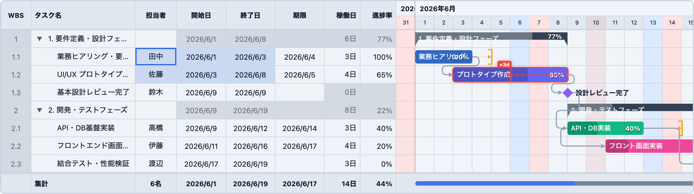
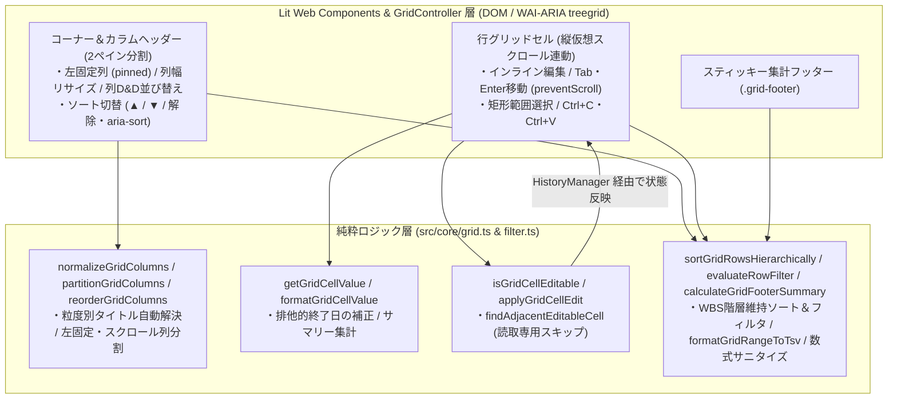
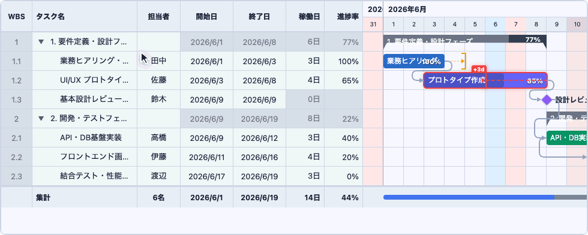
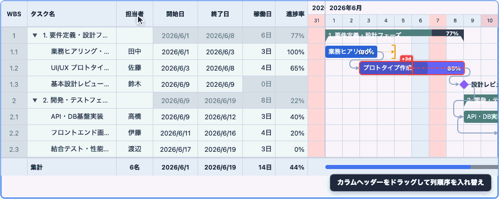
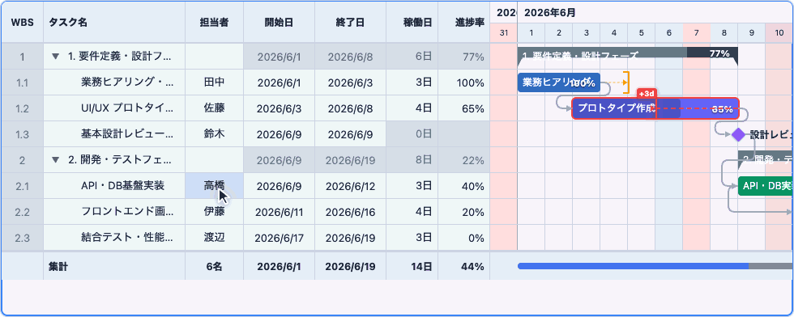

## はじめに

業務システムやプロジェクト管理ツール向けにガントチャートを作ると、最初にぶつかる壁のひとつが **「左ペイン（タスク一覧）の情報量と入力効率」** です。

左側にタスク名だけが並ぶシンプルなリストでは、WBS番号・担当者・開始日・終了日・期限・稼働日数・進捗率を横並びで比較できません。さらに実務では、ほぼ確実に次のような要望が出てきます。

- 「ダイアログをいちいち開かずに、セルを直接ダブルクリックして `Tab` / `Enter` キーで連続入力したい」
- 「Excel や Google スプレッドシートで作った日程表をそのまま矩形範囲でコピー＆ペーストしたい」
- 「列が増えて横スクロールしても WBS 番号やタスク名は左端にピン留め固定し、WBS の親子階層を崩さずにソートや検索フィルタをかけたい」

個人開発しているフレームワーク非依存・MITライセンスの Web Components 製ガントチャートライブラリ **「[@mogura/moguchart-core](https://github.com/hiro-murakami/moguchart-core)」** では、v1.5.0 から最新 **v1.10.0** にかけて、外部のテーブルライブラリや日時ライブラリにも一切依存しない（`lit` ピア依存のみの外部ランタイム依存ゼロ・コア全体 **約 98KB gzipped**） **「マルチカラムデータグリッド ＆ WBS階層維持フィルタ」** をフルスクラッチで実装しました。

https://github.com/hiro-murakami/moguchart-core

本記事では、マルチカラムグリッドの **実践的な API・コード例** と、ガントチャートならではの **内部設計・UI/セキュリティ実装の勘所** を解説します。

実際にブラウザ上で触れるデモサイトも公開していますので、ぜひ合わせてご覧ください！

https://moguchart-core.vercel.app

:::note info
**moguchart-core / MoguChart の関連記事はこちら**

- **コアライブラリの全体紹介**: [フレームワークに縛られないガントチャートを作った — Web Components製「moguchart-core」の紹介](https://qiita.com/hiroyuki_m/items/0e4859951a9f652c26c3)
- **自動スケジューリング編（ペア記事）**: 自動スケジューリングエンジン（FS/SS/FF/SF・営業日計算・SNET/FNLT制約）の設計については別記事で詳しく解説しています（※公開後にURLを差し替え）
- **Webアプリ正式リリース＆最新機能**: [【祝 v1.0】無料でここまで動く！WBS・サマリー自動集計に対応したWebガントチャート「MoguChart」を正式リリースしました](https://qiita.com/hiroyuki_m/items/47f635a93c5e9d831b5a)
:::

---

## アーキテクチャ：`GridController` と純粋関数モジュール `grid.ts` / `filter.ts` の分離

ガントチャートの左ペインにあるグリッドは、単なる独立した表ではありません。セルを1つ書き換えれば右ペインのタスクバーや親階層の WBS サマリーバー、最下部の集計フッターが連動して変化し、さらに `Cmd+Z` 1回で元に戻せる（Undo / Redo）必要があります。

見通しよく保守・テストできるよう、`moguchart-core` では **Lit コンポーネント＆ `GridController` 層（2ペインDOM描画・イベント・WAI-ARIA制御）** と **`src/core/grid.ts` / `src/core/filter.ts`（DOM非依存の純粋関数群）** を明確に分離しています。



計算・変換ロジックをすべて純粋関数として切り出したことで、ブラウザ環境なしの単体テスト（Vitest）でエッジケースを高速に検証できるほか、利用者側からも `partitionGridColumns` や `evaluateRowFilter`、`formatGridRangeToTsv`、`sortGridRowsHierarchically` などのユーティリティ関数を直接 import して活用できます。

---

## 1. 最小構成からカスタムカラムまでの実践コード

従来（v1.4以前）の行ヘッダーは `row.name` を1列表示する構造でしたが、`option.grid` を指定するだけで本格的な複数カラムテーブルに切り替わります（`option.grid` 未指定時は従来通り1列ヘッダーとして100%後方互換で動作します）。

標準の組み込みカラムと、独自の「担当者（`assignee`）」カラムを組み合わせた設定例がこちらです。

```typescript
import '@mogura/moguchart-core'
import type { GanttChartElement, GanttChartOption, GanttRow } from '@mogura/moguchart-core'

interface CustomRow extends GanttRow {
  assignee?: string
}

const rows: CustomRow[] = [
  {
    id: 'row-1',
    name: '1. 要件定義フェーズ',
    tasks: [], // 子階層を持つ親行（配下タスクからサマリーが自動集計される）
  },
  {
    id: 'row-1-1',
    parentId: 'row-1',
    name: 'ヒアリング・業務フロー整理',
    assignee: '田中',
    tasks: [
      {
        id: 't-1',
        name: 'ヒアリング・業務フロー整理',
        start: new Date('2026-06-01T00:00:00'),
        end: new Date('2026-06-05T00:00:00'), // 6/1〜6/4 の4日間（排他的終了日時）
        deadline: new Date('2026-06-06T00:00:00'),
        progress: 80,
      },
    ],
  },
  {
    id: 'row-1-2',
    parentId: 'row-1',
    name: '要件定義書レビュー完了',
    assignee: '佐藤',
    tasks: [
      {
        id: 't-2',
        name: '要件定義書レビュー完了',
        type: 'milestone', // マイルストーンタスク（期間0日）
        start: new Date('2026-06-05T00:00:00'),
        end: new Date('2026-06-05T00:00:00'),
      },
    ],
  },
]

const option: GanttChartOption = {
  calendar: {
    start: new Date('2026-05-28'),
    end: new Date('2026-06-30'),
    pxPerDay: 44,
    calendarMode: 'weekends-holidays',
  },
  grid: {
    enabled: true,
    editable: true,       // セルのインライン編集を有効化
    reorderable: true,    // カラムヘッダーのD&D並び替えを有効化
    sortable: true,       // WBS階層維持カラムソートを有効化
    showFooter: true,     // 最下部にスティッキー集計フッターを表示
    cellSelection: true,  // 矩形セル範囲選択＆TSVコピペを有効化
    width: 640,           // 左ペイン全体の初期表示幅（スプリッターで伸縮可能）
    columns: [
      { id: 'wbs', width: 60, pinned: 'left', reorderable: false }, // 横スクロール時も左端へ固定 (v1.10.0)
      { id: 'name', width: 200, pinned: 'left' }, // 左端固定＋ツリー開閉トグル・階層インデントを自動内包
      {
        id: 'assignee',
        title: '担当者',
        field: 'assignee',        // row.assignee に自動バインド
        width: 90,
        align: 'center',
        editor: 'select',         // ドロップダウン選択エディタ
        editorOptions: [
          { label: '未割当', value: '' },
          { label: '田中', value: '田中' },
          { label: '佐藤', value: '佐藤' },
          { label: '鈴木', value: '鈴木' },
        ],
        // 固定フッターにユニーク担当者数を集計表示
        footerValueGetter: (allRows) => {
          const set = new Set(allRows.map((r: CustomRow) => r.assignee).filter(Boolean))
          return set.size
        },
        footerFormatter: (count) => (count ? `${count}名` : '-'),
      },
      { id: 'startDate', width: 100 },
      { id: 'endDate', width: 100 },
      { id: 'deadline', width: 100 },
      { id: 'workingDays', width: 75 },
      { id: 'progress', width: 75 },
    ],
  },
}

const chart = document.querySelector<GanttChartElement>('gantt-chart')!
chart.rows = rows
chart.option = option
```

### 標準組み込みカラム（`GanttBuiltinColumnId`）一覧

日本語（`jaLocale`）・英語（`enLocale`）のロケール設定に見出しや期間単位が自動連動します。

| カラムID | 既定タイトル | 役割・集計挙動 |
| :--- | :--- | :--- |
| `wbs` | WBS | WBS階層番号（`1`, `1.1`, `1.2.1` 等）を自動採番（自然順ソート対応） |
| `name` | タスク名 | 行名を表示。WBS階層インデントとインラインSVG開閉トグル（▶/▼）を内包 |
| `startDate` | 開始日 ※ | 単一タスクは開始日、サマリー行・複数タスク行は最小開始日を自動算出 |
| `endDate` | 終了日 ※ | 単一タスクは終了日、サマリー行・複数タスク行は最大終了日を自動算出 |
| `deadline` | 期限 | タスクのデッドライン日時を表示。期限超過時は赤字でハイライト強調 |
| `duration` | 期間 | 暦日数スパン（時間単位モード時は `2時間30分` 等の時間表記に自動適応） |
| `workingDays` | 稼働日 | 定休日・祝日を除いた実営業日数を自動算出。数値編集時は終了日を逆算更新 |
| `progress` | 進捗率 | 進捗率（`%`）。サマリー行・複数タスク行は期間加重平均進捗率を自動算出 |

---

## 2. ガントチャート特有のグリッド設計の勘所

汎用的なデータテーブルと異なり、ガントチャート用のグリッドには時間軸や階層構造と密結合した特有の難所があります。特に工夫した3つの設計ポイントを紹介します。

### ① 「排他的終了日時（翌日 `00:00`）」と人間向け表記のギャップ吸収

タイムライン描画エンジンで日単位の期間を扱う際、最も計算しやすい表現は **半開区間 `[start, end)`（排他的終了境界）** です。
たとえば「6月1日〜6月4日の4日間」のタスクは、内部データとして `start: 2026-06-01 00:00`、`end: 2026-06-05 00:00` を保持します。これにより `end - start = 4日間` と座標・期間計算が完全に一致します。

しかし、グリッドの「終了日」セルにそのまま `2026/06/05` と出してしまうと、ユーザーは「6月5日まで作業がある（5日間）」と誤認してしまいます。さらに **マイルストーンタスク（`type: 'milestone'`、`start === end === 2026-06-05 00:00`、期間 `0日`）** が混在するため、無条件に `-1日` するわけにもいきません。

そこで `formatGridCellValue` / `formatGridCellEditValue` / `applyGridCellEdit` の3箇所で以下の双方向正規化を行っています。

- **通常タスクの日単位表示・編集**: `end`（および `deadline`）が `00:00` 境界かつ `start < end` の場合、**表示時とエディタ初期値では前日（`2026/06/04`）へ補正**し、編集確定時には**内部的に翌日 `00:00`（`2026-06-05 00:00`）へ戻して保存**する（月単位モードでも同様に終了月を前月表記・翌月1日保持として変換）。
- **マイルストーンタスク**: 期間・稼働日を `0日`（編集不可）とし、`startDate` と `endDate` の両方に同一日付を表示。どちらのセルを編集しても排他的オフセットなしで `start` と `end` を同一時刻に同期更新する。

### ② 表示モード切り替えへの自動カラム適応

ガントチャートの表示粒度を「日単位 ⇄ 月単位 ⇄ 時間単位」と切り替えた際、カラム定義を毎回作り直すのは煩雑です。`normalizeGridColumns()` では `{ id: 'startDate' }` の1定義だけで、現在の表示モードを検知して自動的に適応させます。

- **日・週単位モード**: 見出し `開始日` / 表記 `2026/06/01` / エディタ `'date'`
- **月単位モード（`pxPerMonth` 指定時）**: 見出し `開始月` / 表記 `2026/6` / エディタ `'month'`
- **時間単位モード（`showTime: true` 時）**: 見出し `開始日時`（列幅も `100px → 130px` へ自動拡張）/ 表記 `2026/06/01 09:30` / エディタ `'datetime'`

### ③ 独立横スクロール同期・左端ピン留め固定（`pinned: 'left'`）＆ 列D&D並び替え

表示カラムが増えて合計幅が左ペイン枠を超えた場合、右側のタイムラインとは独立して**左ペイン内だけを横スクロール**できる必要があります。しかし、ヘッダー（`<gantt-calendar>` 側コーナー領域）と各行セル（`<gantt-row>` 群）、固定フッター（`.grid-footer`）は縦仮想スクロールの都合上、別々のDOMコンテナに分かれています。

`moguchart-core` ではグリッド横スクロール量（`gridScrollLeft`）を単一状態として一元管理し、トラックパッドの横スワイプや `Shift + ホイール`、ヘッダー上のホイール操作を捕捉して全コンテナへ同一フレーム内で同期反映することで、**1px のラグもズレもない横スクロール** を実現しています。

さらに **v1.10.0** では、スプレッドシートの「列の固定」にあたる **左端ピン留め固定カラム（`GanttColumn.pinned: 'left' | true`）** に対応しました。

- **2ペイン分割描画（`partitionGridColumns`）**: 可視カラムを「左固定グループ（`pinnedColumns`）」と「スクロールグループ（`scrollableColumns`）」に分割し、スクロールグループ側にのみ `gridScrollLeft` オフセットを適用することで、WBS番号やタスク名を常時左端に固定表示したまま右側の開始日・期限・担当者列だけを滑らかに横スクロールできます。
- **グループ境界を守る列D&D並び替え**: カラムヘッダーをドラッグ＆ドロップして列順序を入れ替える際（`column-reorder` イベント）、青い縦インジケーターを表示しつつ、固定グループとスクロールグループを跨ぐドロップは自動的に抑止してレイアウト整合性を保ちます。
- **Excel ウィンドウ枠固定との自動連動**: 公式 Excel エクスポートプラグイン（`@mogura/moguchart-plugin-excel` v1.10.0）と併用すると、`chart.option.grid.columns` のピン留め列数を自動検出し（または `frozenColumns` オプションで明示指定）、出力される Excel シートの **ウィンドウ枠固定（`xSplit`）** へそのまま反映されます。

---

## 3. インラインセル編集と連続ナビゲーション（`Tab` / `Enter`）

セルのダブルクリック（またはセル選択中の `Enter` / `F2` キー）でインライン編集が開始されます。`Tab` キーで右隣の編集可能セルへ、`Enter` キーで下の行の同一カラムへとスプレッドシート感覚で連続入力でき、変更内容は右側のタスクバーや集計フッターへリアルタイムに反映されます。



### カスタム DOM エディタの実装例

6種類の組み込みエディタ（`'text' | 'number' | 'date' | 'datetime' | 'month' | 'select'`）に加え、`editor` に関数を渡すことで **任意の `HTMLElement`（検索ポップオーバーやタグ入力UIなど）** をマウントできます。

コンテキストの `commit(newValue, navigationDirection?)` を呼ぶだけで、カスタムエディタからでも標準の連続セル移動へそのまま接続できます。

```typescript
import type { GanttColumn } from '@mogura/moguchart-core'

const customTagColumn: GanttColumn = {
  id: 'tags',
  title: 'タグ',
  field: 'tags',
  width: 140,
  editor: ({ value, commit, cancel }) => {
    const input = document.createElement('input')
    input.type = 'text'
    input.value = Array.isArray(value) ? value.join(', ') : String(value ?? '')
    input.placeholder = 'カンマ区切りで入力'
    input.style.cssText = 'width: 100%; height: 100%; box-sizing: border-box; padding: 0 6px;'

    input.addEventListener('keydown', (e) => {
      if (e.key === 'Tab') {
        e.preventDefault()
        const nextTags = input.value.split(',').map((s) => s.trim()).filter(Boolean)
        // 確定と同時に右隣（Shift+Tabなら左隣）の編集可能セルへ移動
        commit(nextTags, e.shiftKey ? 'prev' : 'next')
      } else if (e.key === 'Enter') {
        e.preventDefault()
        const nextTags = input.value.split(',').map((s) => s.trim()).filter(Boolean)
        // 確定と同時に下の行（Shift+Enterなら上の行）の同一カラムへ移動
        commit(nextTags, e.shiftKey ? 'up' : 'down')
      } else if (e.key === 'Escape') {
        e.preventDefault()
        cancel()
      }
    })

    return input
  },
}
```

### 読み取り専用セルを自動スキップする `findAdjacentEditableCell`

ガントチャートのグリッドには、性質上 **直接編集できないセル** が多数存在します。

- 自動採番される `wbs` カラム
- 子階層を持つ **サマリー行（親行）** や **1行複数タスク行** の日付・期間・進捗セル（自動集計値のため）
- **マイルストーン行** の `duration` / `workingDays` / `progress` セル
- `movable: 'none'` や `resizable: false` でロックされたタスクのセル

もし `Tab` や `Enter` で単純に「隣のセル」へフォーカスを移すと、編集不可セルにぶつかった瞬間に連続入力が途切れてしまいます。
そこで `isGridCellEditable()` で編集可否を厳密に判定しつつ（CSSでも `.grid-cell-readonly` で視覚的に区別）、`findAdjacentEditableCell()` が**読み取り専用セルを自動的に飛び越えて次の編集可能セル（行末なら次行の先頭編集可能セル）を探し出す**設計にしました。移動先が仮想スクロールの画面外にある場合も、自動で縦横スクロールを補正してからエディタを開きます。

---

## 4. 階層維持ソート・フィルタリング・固定集計フッター・TSVコピペ（v1.9.0〜v1.10.0）

v1.9.0〜v1.10.0 では、スプレッドシートとしての実用性を決定づけるソート・集計・TSV連携、ならびに WBS ツリー構造と調和するフィルタリング＆アクセシビリティ機能を実装しました。

### ① WBS階層を壊さないソート（`sortGridRowsHierarchically`）

フラットな `rows` 配列に対して単純な `Array.prototype.sort` をかけると、親子ツリー構造（大工程 ＞ 中工程 ＞ 詳細タスク）がバラバラに壊れてしまいます。

`sortGridRowsHierarchically()` では、`parentId` から親子マップを構築し、**同じ親を持つ兄弟ノード（Siblings）同士のみを比較・並び替えながら深さ優先（DFS）で再展開**します。

- カラムヘッダーをクリックするたびに `昇順 (▲)` → `降順 (▼)` → `ソート解除` の3段階で遷移。
- 空値（未設定の期限日など）は昇順・降順どちらでも常に末尾へ配置し、同値の場合は元の順序を保つ安定ソート。
- `wbs` カラムは文字列比較（`"1.10" < "1.2"` になる問題）ではなく、各階層番号を数値として比較する自然順ソート（`compareWbsCodes`）を適用。



### ② 二重計上を防ぐ固定集計フッター（`showFooter`）

`option.grid.showFooter: true` を指定すると、グリッド最下部にスティッキー固定の集計フッター行が表示されます。
親のサマリー行と子の詳細行をそのまま合算すると二重計上になるため、`calculateGridFooterSummary()` では **`parentId` の参照先になっていないリーフ行（葉行）の通常タスクのみ** を自動抽出して、全体の最小開始日・最大終了日・最大期限日・稼働日数・期間加重平均進捗率を算出しています。

### ③ 矩形セル範囲選択 ＆ Excel 互換の双方向 TSV コピペ

セルのクリック、`Shift + クリック`、ドラッグ、`Shift + 矢印キー` で複数行×複数列の矩形セル範囲を選択できます。

- **`Ctrl/Cmd + C`（コピー）**: `formatGridRangeToTsv()` が選択範囲をタブ区切りテキスト（TSV）に変換してクリップボードへコピー。そのまま Excel や Google スプレッドシートに貼り付けられます。
- **`Ctrl/Cmd + V`（ペースト）**: スプレッドシート側でコピーしたセル範囲を `parseTsvString()` で2次元配列として受け取り、選択セルを左上起点として一括反映します。

複数セルへの一括ペーストは **`HistoryManager` に1つのバッチコマンドとして記録** されるため、`Cmd+Z` 1回でペースト前の状態にまとめて戻せます。



### ④ WBS階層を維持するフィルタリング・検索エンジン ＆ WAI-ARIA `treegrid` 対応（v1.10.0）

行数が増えてくると「担当者名やキーワードで検索したい」「期限超過（`overdue`）のタスクだけを抜き出したい」というニーズが生まれます。しかし、ソートと同様にフラットな配列へ単純なフィルタをかけると、ヒットした詳細タスクの親行（大工程・中工程）が消えてしまい、「どのフェーズの作業なのか」という文脈が失われてしまいます。

v1.10.0 で新設した **`src/core/filter.ts`（`option.filter` / `chart.setFilter()`）** では、グリッド列の値（`getGridCellValue`）も含めた複合検索と WBS ツリー構造の維持を両立しています。

```typescript
// 宣言的オプション (option.filter) または命令的メソッドで絞り込み
const result = chart.setFilter({
  query: '田中',              // 行名・タスク名・WBSコード・可視グリッド列（担当者など）を横断部分一致検索
  status: 'overdue',          // 'all' | 'incomplete' | 'completed' | 'overdue' | 'inProgress'
  mode: 'hide',               // 'hide'（祖先行を残して非一致行を隠す）| 'dim'（全行表示のまま非一致を減光）
  autoExpandMatches: true,    // 一致した子孫を持つ折りたたみ中の親行を自動で一時展開
})
console.log(`一致: ${result.matchedRowCount} 行 / 表示: ${result.visibleRowCount} 行`)
```

また、業務アプリへの埋め込み品質を高めるため、セル操作やエディタ起動時のフォーカス処理に `focus({ preventScroll: true })` を徹底して親ページ全体の意図せぬスクロールジャンプを防止したほか、チャートホストに `role="treegrid"`、列ヘッダーに `role="columnheader"` / `aria-sort`、各行に `role="row"` / `aria-level` / `aria-expanded` / `aria-selected` を付与する標準 **WAI-ARIA アクセシビリティ** にも対応しています。

---

## 5. セキュリティ設計と React / Vue 連携

### スプレッドシート数式インジェクション対策とプロトタイプ汚染ガード

外部クリップボードとの連携や動的フィールド参照を行うUIライブラリでは、防御的なセキュリティ実装が欠かせません。v1.9.0 では以下の保護を標準搭載しています。

```typescript
const FORMULA_TRIGGER_RE = /^[ \t]*(?:[=@]|[+-](?=\S))/
const SAFE_SIGNED_NUMBER_RE = /^[ \t]*[+-]?\d+(?:\.\d+)?%?$/

export function sanitizeSpreadsheetFormula(text: string): string {
  if (!text) return text
  // "+15" や "-3.5%" などの純粋な符号付き数値・パーセント表記はそのまま維持
  if (SAFE_SIGNED_NUMBER_RE.test(text)) return text
  // "=", "@", "+...", "-..." で始まる数式トリガー文字列には先頭に "'" を付与して無害化
  if (FORMULA_TRIGGER_RE.test(text)) {
    return `'${text}`
  }
  return text
}
```

- **数式インジェクション防止（`sanitizeSpreadsheetFormula`）**: タスク名などに `=HYPERLINK(...)` や `=CMD|...` が含まれていた場合、TSVコピー時および Excel エクスポート時に先頭へシングルクォート `'` を付与して無害化します（`+10%` のような通常の数値表記は壊さず維持し、グリッドへ再ペーストする際は自動アンエスケープします）。
- **プロトタイプ汚染ガード（`isUnsafePropertyKey`）**: カスタムカラムの `field` 解決・更新時に `__proto__` / `constructor` / `prototype` をブロックします。

### 公式 React ラッパーでのイベント連携例

`@mogura/moguchart-react`（または `@mogura/moguchart-vue`）を使えば、セル編集・列並び替え・ソート・TSVペーストのすべてを型安全なイベントとして扱えます。

```tsx
import { useRef, useState } from 'react'
import { GanttChart } from '@mogura/moguchart-react'
import type { GanttChartElement, GanttChartOption, GanttRow } from '@mogura/moguchart-core'

export function WbsGridGantt({ initialRows, option }: { initialRows: GanttRow[]; option: GanttChartOption }) {
  const chartRef = useRef<GanttChartElement>(null)
  const [rows, setRows] = useState<GanttRow[]>(initialRows)

  return (
    <GanttChart
      ref={chartRef}
      rows={rows}
      option={option}
      onRowsChange={(e) => setRows(e.detail.rows)}
      onCellEdit={(e) => {
        console.log(`編集: row=${e.detail.rowId}, col=${e.detail.columnId}`, e.detail.newValue)
      }}
      onCellPaste={(e) => {
        console.log(`${e.detail.changes.length} セルを一括ペーストしました`)
      }}
      onColumnReorder={(e) => {
        // 並び替え後のカラム順序 (e.detail.columnIds) をユーザー設定として保存可能
        console.log('新しい列順序:', e.detail.columnIds)
      }}
      onColumnSort={(e) => {
        console.log('ソート状態:', e.detail.sortState)
      }}
      onFilterChange={(e) => {
        console.log(`フィルタ適用: ${e.detail.result.matchedRowCount} 件一致`)
      }}
      style={{ height: '600px', width: '100%' }}
    />
  )
}
```

---

## まとめ

`@mogura/moguchart-core`（最新 v1.10.0）のマルチカラムデータグリッドは、**`lit` ピア依存のみの外部ランタイム依存ゼロ・コア全体約 98KB (gzipped)**（Node16 / NodeNext 厳密 ESM 対応）という軽量さを保ちながら、以下の機能をワンパッケージで提供します。

- `option.grid` による組み込みカラム＆自由なカスタムカラム定義、および `role="treegrid"` 準拠の WAI-ARIA アクセシビリティ対応
- 排他的終了日時（翌日 `00:00`）の人間向け補正、日/月/時間モードへの自動適応、左端ピン留め固定列（`pinned: 'left'` ＆ Excel 枠固定自動連動）と 1px もズレない独立横スクロール同期
- カスタム DOM エディタ対応と、読み取り専用セルを自動スキップする `Tab` / `Enter` 連続セル編集（親ページスクロール抑止対応）
- WBS階層を壊さないソート＆横断検索フィルタ（`setFilter`）、二重計上を防ぐ固定集計フッター、数式インジェクション対策付きの矩形セル TSV コピペ

なお、本グリッド機能は私が開発・運営している無料 Web ガントチャートアプリ **「[MoguChart（moguchart.jp）](https://moguchart.jp)」**（最新 v1.10.1）の本番環境でもフル稼働しています（登録不要のゲストログインですぐに試せます）。さらにグリッド上で日付や稼働日を編集した際、後続タスクを営業日ベースで自動連鎖移動させる **「自動スケジューリングエンジン」** については、ペアとなる別記事で詳しく解説していますので、ぜひ合わせてご覧ください！

## 参考リンク

- **GitHub リポジトリ**: [hiro-murakami/moguchart-core](https://github.com/hiro-murakami/moguchart-core)
- **ライブデモサイト**: https://moguchart-core.vercel.app
- **API リファレンス（日本語）**: [doc/API.ja.md](https://github.com/hiro-murakami/moguchart-core/blob/develop/doc/API.ja.md)
- **本番採用 Web アプリ「MoguChart」**: https://moguchart.jp
