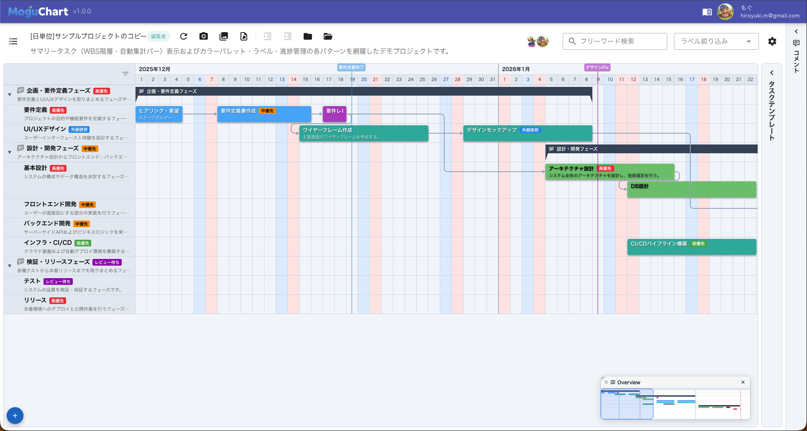
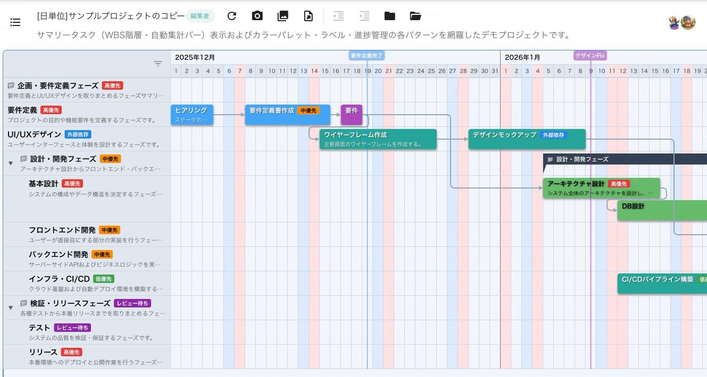
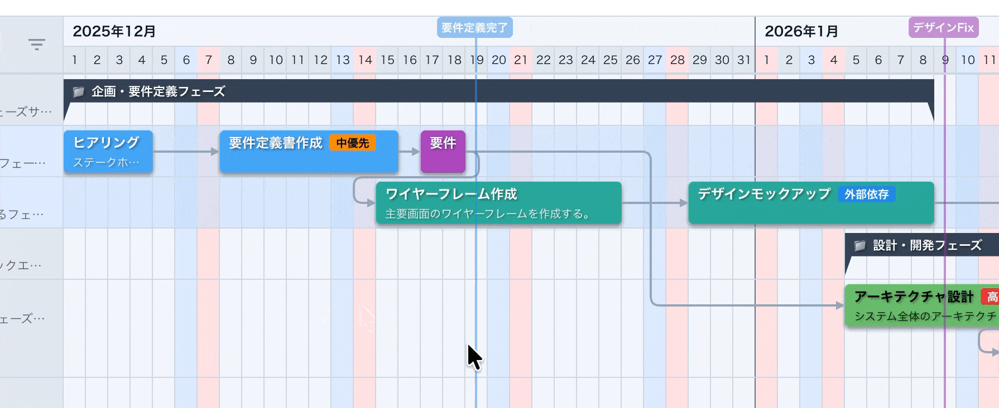
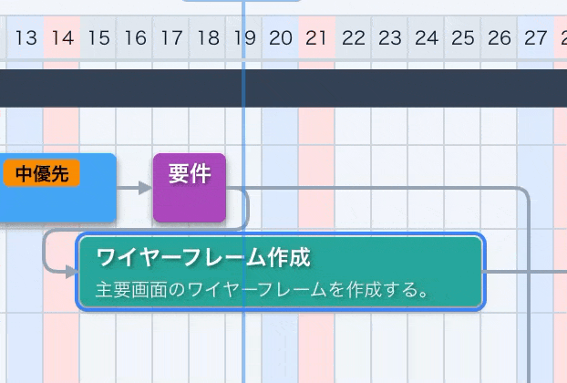
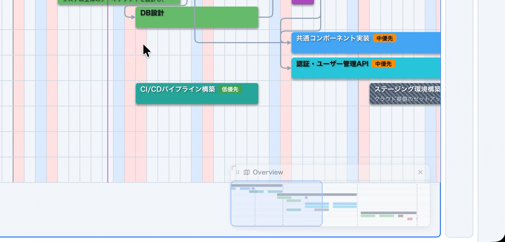
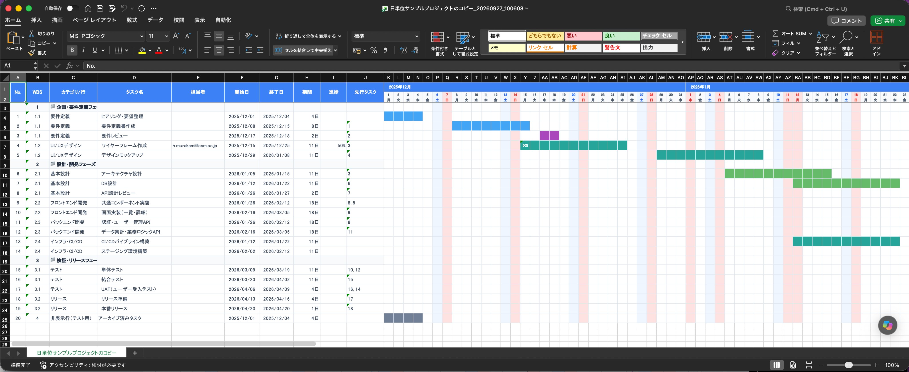

## はじめに

個人開発でガントチャート描画エンジンから自作してきた Web アプリケーション **「[MoguChart（モグチャート）](https://moguchart.jp)」** が、ついに **メジャーバージョン 1.0.0** に到達しました！🎉

https://moguchart.jp

「ガントチャートだけを徹底的に、かつ直感的にサクサク使いたい」という想いで開発を続け、実務レベルのプロジェクト管理に不可欠な **WBS（階層ツリー構造・行の開閉）** と **サマリータスク（自動集計・描画）** を搭載した正式版となります。

Google アカウントでのログインはもちろん、**登録不要の「ゲストログイン」** でアクセス後 1 秒ですぐにお試しいただけます。

---

## こんな人におすすめ

- 📊 **Excel やスプレッドシートのガントチャートで、セル結合や行追加のズレに疲弊している人**
- 🛠 **海外製のプロジェクト管理ツールは多機能すぎて重い、あるいは学習コストや費用が高いと感じている人**
- 🖱 **とにかくドラッグ＆ドロップで、直感的に日程や進捗率をグリグリ動かしたい人**
- 🤝 **チームメンバーと同じ画面を見ながらリアルタイムに共同編集したい人**

---

## v1.0 の最大の進化：WBS ＆ サマリー自動集計

v1.0.0 リリースの最大のハイライトは、中〜大規模プロジェクトを整理するために欠かせない **WBS（Work Breakdown Structure）** と **サマリータスク** の全面サポートです。

### 1. 無制限の階層ツリー ＆ ワンクリック開閉

- 行のメニューから「インデント（子行化）」「アウトデント（親レベルへ昇格）」を直感的に切り替え可能。
- 親行の左側に表示される開閉トグルアイコン（▶ / ▼）で、配下の子孫タスクを**ワンクリックで展開・折りたたみ**できます。
- 親行をドラッグして並び替えると、配下の子孫行も**ブロックとして一体となって安全に追従移動**します（循環参照も自動防止）。

### 2. サマリータスクの期間・進捗率を自動集計

- 子階層を持つ親行には、配下の全タスクの「最小開始日」〜「最大終了日」、そして「期間加重平均進捗率」を自動集計した**サマリーバー（ブラケット形状）**が自動描画されます。
- 子タスクの期間や進捗率をマウスで変更すると、親のサマリーバーもリアルタイムに連動して更新されます。
- 親行自身に通常タスクが登録されている場合でも、上段にサマリーバー、下段に通常タスクが並んで描画される**二段共存描画**に対応しています。

---

## MoguChart のここが便利！推し機能 5 選

v1.0 に至るまでに磨き込んできた、直感的な操作感を支える機能たちです。

### ① 登録不要！1クリックで試せるゲストログイン

「試すためだけにアカウント登録するのはちょっと…」という方でも安心です。
トップページの「ゲストとして利用」ボタンを押すだけで、登録不要ですぐに全機能をブラウザ上でお試しいただけます。

### ② 空白ドラッグで一括操作！「矩形範囲選択（ラバーバンド）」

ガントチャートの空白エリアをドラッグすると、青い選択枠（ラバーバンド）が出現し、範囲内の複数タスクを一括選択できます。
そのまま一括ドラッグ移動、キーボードによる日付微調整、一括コピー＆ペースト（Cmd+C / Cmd+V）、一括削除がシームレスに行えます。

### ③ つまんで動かす「進捗率ドラッグ編集」

タスクバーの右端にある進捗ハンドルをマウスでドラッグするだけで、進捗率（0〜100%）を 5% 刻みで直感的に変更できます。
進捗管理を行わないシンプルなプロジェクトでは、設定から進捗率表示をまるごと OFF にすることも可能です。

### ④ 巨大なプロジェクトでも迷子にならない「ミニマップ（鳥瞰ビュー）」

画面右下にガントチャート全体を俯瞰できるミニマップを搭載しています。
ミニマップ内の表示枠をドラッグするだけで、見たい期間・エリアへ瞬時にジャンプできます。半透明化・リサイズ・最小化にも対応しています。

### ⑤ リアルタイム共同編集 ＆ 画像付き ZIP バックアップ

- **リアルタイム共同編集**: チームメンバーと同じプロジェクトを同時に編集でき、誰がオンラインかもアバターでひと目で把握できます。
- **画像添付 ＆ 完全復元**: タスクや行にクリップボード（Ctrl+V）から直接画像を貼り付け可能。画像ファイルを含めたプロジェクト全体を 1 つの ZIP ファイルとして丸ごとエクスポート＆完全復元（リストア）できます。

---

## その他の実務向け機能も充実

- **時間単位・日単位・月単位の表示切り替え**（最大 100 年の長期ロードマップにも対応）
- **クリティカルパスの自動検出 ＆ ハイライト表示**
- **拡張依存関係（FS / SS / FF / SF・ラグ）＆ 営業日・カスタム定休日ベースの自動スケジューリング**
- **マイルストーン（全体目標の縦ライン ＆ 行内の単一時点タスク `◆`）と行マーカー（工程目標）の可視化**
- **タイムライン付き Excel (.xlsx) / 高画質 PNG / PDF エクスポート**（オンデマンド動的インポート対応、印刷や社内・取引先への報告用）
- **公開 URL 発行**（ログイン不要で第三者に閲覧専用リンクを共有）
- **REST API (OpenAPI 3.1 準拠) ＆ Google Apps Script (GAS) 連携**

---

## 🚀 【Update】さらに進化した v1.9.0 の改善点

正式リリース後もユーザー体験の向上と機能追加を続け、最新の **v1.9.0** では以下の大型アップデートを実施しました！

1. **マルチカラムグリッドの機能拡充（名前・担当者セルのインライン編集・連続セル移動・カラムD&D並び替え）（v1.9.0 / core v1.8.0連携）**:
   - **「名前（タスク名）」セルのインライン編集**: マルチカラムグリッドの「名前」セルをダブルクリックすることで、行ヘッダーのタスク名表示位置・フォントサイズに合わせた専用のテキスト入力エディタを展開し、その場でスムーズにタスク名を直接編集可能になりました
   - **「担当者（`assignees`）」セルのインライン編集**: マルチカラムグリッドの「担当者」セルをダブルクリックすることで、ダイアログを開かずにポップオーバー形式の専用セルエディタからタスクの担当者をその場で選択・追加・解除可能になりました。選択中ユーザーのチップ表示（個別解除・全解除ボタン付き）、プロジェクトメンバーやコラボレーターのインクリメンタル検索・複数チェック選択（アバター・表示名・メールアドレス・「あなた」バッジ付き）、および未登録メールアドレスの直接入力追加に対応し、Undo / Redo および楽観的 UI 更新とも完全連携します
   - **キーボードによる連続セル編集ナビゲーション（`Tab` / `Shift+Tab` / `Enter` / `Shift+Enter`）**: セル編集中に `Tab` / `Shift+Tab` で右隣・左隣の編集可能なセルへ（行端では前後行へ折り返し）、`Enter` / `Shift+Enter` で下の行・上の行の同じカラムの編集可能なセルへ確定と同時に連続移動できるキーボードナビゲーションを追加しました（編集不可のセルは自動スキップ）
   - **カラムヘッダーのドラッグ＆ドロップ並び替え（`gridColumnOrder`）**: マルチカラムグリッドのカラムヘッダーをドラッグ＆ドロップして列の表示順序を自由に入れ替え可能に。並び替えた順序や各カラム幅はプロジェクトごとのユーザー設定として自動保存・復元されます

2. **タスクテンプレート表示のプロジェクト設定 ＆ レスポンシブ UI 最適化（v1.9.0）**:
   - プロジェクト詳細ダイアログの「編集オプション」タブに **「タスクテンプレートを表示する」** スイッチ（デフォルトOFF）を追加。タスクテンプレートを使用しないプロジェクトでは画面右側のサイドバーを非表示にし、チャート領域を広く確保できるようになりました
   - 画面サイズ（小画面・横向きモバイル等）に応じてアプリバー・プロジェクトヘッダー・ツールバー・検索フィールド・スナップショット比較バナーを自動的にコンパクト化するレスポンシブ対応を実施。さらにラベルフィルタに `ResizeObserver` による動的幅計測を導入し、表示幅に応じてチップ表示数を自動調整するよう改善しました

3. **タスクレベルのマイルストーン機能（行内マイルストーン ＆ テンプレート連携）（v1.8.0 / core v1.7.0連携）**:
   - プロジェクト全体を貫く従来の「全体マイルストーン（縦の旗ライン）」に加え、各工程（行）のタイムライン上に単一時点（期間 `0日`）の節目をひし形（`◆`）シンボル（`type: 'milestone'`）として配置できる「タスクレベルのマイルストーン」機能を追加しました
   - ひし形の右外側にタスク名・ロックアイコン（🔒）・ラベルバッジ・コメント数バッジ・添付画像サムネイルが横並びで美しく描画され、ミニマップにもひし形シンボルが反映されます（同一行・同一日時の複数マイルストーンは別レーンへ自動分離）
   - チャート空白箇所の右クリックメニュー「新規マイルストーン」、タスク編集ダイアログ上部の「通常タスク / マイルストーン」種別切り替えトグル、およびタスクテンプレート（`TaskTemplateDialog`）からのサイドバー D&D 配置に対応
   - 期間リサイズと進捗率編集を自動無効化しつつ、ドラッグ移動・コピー＆ペースト・左右コネクタからの依存関係作成・自動スケジューリング・マルチカラムグリッド（期間・稼働日 `0日` 表示、開始日/終了日の同期編集）・CSV/Excel エクスポート（工程表シートでの `◆` 描画）と完全統合されています

4. **カスタム定休日（曜日・特定期間）＆ ドラッグ時の稼働日数維持 ＆ 休日名ツールチップ（v1.8.0 / core v1.7.0連携）**:
   - プロジェクト詳細ダイアログに独立した「スケジューリング」タブを新設し、休業とする曜日（`nonWorkingDays`：土日以外も含む日〜土のチップ選択）をプロジェクトごとに自由に変更可能になりました
   - 夏季休暇・年末年始・計画メンテナンス日などの特定日や期間を個別に登録できる「カスタム定休日（`nonWorkingDates`）」機能を追加。任意の休日名と背景色を設定でき、営業日ベースの自動スケジューリング・稼働日数計算・Excel エクスポートの休日ハイライトすべてに反映されます
   - 営業日ベース選択時に「ドラッグ移動時に稼働日数を維持する（`preserveWorkingDaysOnDrag`）」オプションをONにすると、ドラッグ移動で休日やカスタム定休日を跨いだ際に翌営業日へ自動スナップしつつ、元の実稼働日数を維持するよう終了日が自動伸縮されます
   - 日単位モードのカレンダーヘッダーで、日本の国民の祝日（例: `憲法記念日`）や休日名付きカスタム定休日（例: `夏季休暇`）の日付セルにマウスオーバーすると、祝日名・休日名がツールチップで表示されます

5. **プロジェクト一覧の「スター付き（⭐）」お気に入り管理（v1.8.0）**:
   - プロジェクト一覧ダイアログ（`ProjectListDialog`）の各行左端にスタートグルボタン（⭐）を追加し、よく使うプロジェクトや重要案件をワンクリックでお気に入り登録可能になりました
   - ダイアログ左側の縦タブが「メイン / スター付き / アーカイブ済」の3タブ構成へ拡張され、多数のプロジェクトを抱える環境でも目的のプロジェクトへ瞬時にアクセスできます

6. **拡張依存関係（FS / SS / FF / SF）＆ ラグ / リード設定、接続線の編集ダイアログ（v1.7.0 / core v1.6.0連携）**:
   - 従来の「終了 → 開始（FS）」に加え、「開始 → 開始（SS）」「終了 → 終了（FF）」「開始 → 終了（SF）」の全4種類の依存関係に対応。ラグ（遅延）/ リード（前倒し）期間も設定できるようになりました
   - タスクバー左端（開始）/ 右端（終了）のコネクタからドラッグして接続線を作ると、接続元・接続先の端点から種別を自動判定し、正しい始点・終点に矢印を描画します
   - 接続線のダブルクリック、または右クリックメニュー「接続線を編集」から専用ダイアログ（`DependencyEditDialog`）を開き、種別とラグを直感的に編集・削除可能。保存時には「自動スケジューリングしますか？」の確認ダイアログから、変更後の制約で後続タスクをその場で再計算できます
   - 同一行内で先行・後続タスクが接している場合は自動的に別レーンへ分離し、接続線が潰れて選択しづらくなる問題も解消しました

7. **自動スケジューリング ＆ 手動後続スケジューリング（v1.7.0 / core v1.6.0連携）**:
   - プロジェクト設定の「スケジューリング」タブで「自動スケジューリングを行う」をONにすると、タスクのドラッグ移動・リサイズ・一括移動・キーボード移動・グリッドのセル編集・ダイアログでの保存・接続線の追加に合わせて、後続タスクの日程がトポロジカル順に自動で連鎖調整されます（ロックされたタスクは保護）
   - 連動モードは、日程が逆転した場合のみ後ろへ押し出す「押し出しのみ（`push-only`）」と、前倒しも含めて常に追従させる「厳密追従（`strict`）」から選択可能
   - 自動スケジューリングがOFFでも、タスク（複数選択可）の右クリックメニュー「後続タスクをスケジューリング」から、選択タスクを起点に後続タスクをワンクリックで一括調整できます
   - 連鎖更新された複数タスクは楽観的 UI で即座に画面へ反映され、1回の Undo / Redo（`Cmd+Z` / `Ctrl+Z`）でまとめて取り消し・やり直しが可能。バックエンドでも担当者同期処理をトランザクション内の一括バッチ処理へ最適化し、一括更新時のレスポンスを大幅に改善しました

8. **営業日ベースのスケジューリング ＆ 「稼働日」表示（v1.7.0〜v1.8.0 / core v1.6.0〜v1.7.0連携）**:
   - スケジューリングの稼働日設定として「カレンダー通り」「営業日ベース（定休日を除外）」「営業日ベース（定休日・祝日を除外）」の3種類から選択可能に。営業日ベースでは、後続タスクの着地日が非営業日なら翌営業日へ自動スキップし、各タスクの実稼働日数と接続線のラグを営業日換算で維持したまま期間を自動伸縮します
   - 日単位モードで営業日ベースを選ぶと、マルチカラムグリッドに標準組み込みの「稼働日（`workingDays`）」カラムが追加されます。セルの数値をインライン編集すると、非営業日をスキップして指定稼働日数ぶん確保されるよう終了日が自動で再計算されます
   - タスクのツールチップ（スナップショット差分比較時の当初計画を含む）にも、カレンダー日数と併せて稼働日数（例: `5日 / 稼働3日`）が表示されます

9. **マルチカラムグリッド表示機能（WBS・担当者・日程・期間・稼働日・進捗の一覧テーブル）（v1.6.0〜v1.9.0 / core v1.5.0〜v1.8.0連携）**:
   - 行ヘッダー領域を拡張し、「名前（行名・タスク名）」に加えて「WBS」「担当者」「開始日（開始月 / 開始日時）」「終了日（終了月 / 終了日時）」「期間」「稼働日」「進捗」の各カラムをテーブル形式で並べて一覧表示できるようになりました
   - 表示設定メニューから表示するカラムをチップ選択で自由にON/OFF切り替え可能（WBSカラムはデフォルト非表示、進捗管理OFFのプロジェクトでは進捗カラムを自動非表示）。プロジェクトの表示粒度（日単位・月単位・時間単位）に応じて開始・終了カラムの見出しと日付フォーマットが自動的に切り替わります
   - **担当者（Assignees）カラムと省略時ツールチップ**: 行内のタスクに割り当てられた担当者の表示名（またはメールアドレス）を自動集約して表示し、セル幅を超えて省略表示（`...`）されている場合のみマウスオーバーで全文ツールチップを表示
   - **コーナーセルの2段レイアウト ＆ クイック開閉ボタン**: 左上コーナーセル右端にマルチカラムグリッド開閉ボタン（`>` / `<` シェブロンアイコン）を配置し、チャート上からワンクリックでグリッドの展開・折りたたみを切り替え可能。グリッド展開時は上段に操作ボタン群（インライン編集切替・行ラベルフィルタ・グリッド開閉）、下段にカラムヘッダーを配置する2段レイアウトへ自動移行
   - **カラムD&D並び替え・幅リサイズと設定の永続化**: カラムヘッダーのドラッグ＆ドロップによる列の並び替えや、各カラム境界ドラッグによる幅調整が可能。グリッド表示状態・表示カラム構成・列の並び順・各カラム幅・インライン編集設定がプロジェクトごとのユーザー設定として自動保存・復元されます

10. **グリッドセルのインライン編集機能（v1.6.0〜v1.9.0 / core v1.5.0〜v1.8.0連携）**:
    - マルチカラムグリッド内の各セル（名前・担当者・開始日・終了日・期間・稼働日・進捗）をダブルクリックすることで、ダイアログを開かずにその場で直接値を入力・変更可能になりました（編集中は `Tab` / `Shift+Tab` / `Enter` / `Shift+Enter` で隣接セルへ連続移動可能）
    - 表示設定メニュー内のスイッチ、またはグリッド表示中の左上コーナーセルに配置された鉛筆アイコンボタン（✏️）から、セルのインライン編集の有効 / 無効をワンクリックで即座に切り替え可能
    - セル編集による行名やタスク属性の変更は Undo / Redo 履歴（`Cmd+Z` / `Ctrl+Z`）・リアルタイム共同編集・自動スナップショットと完全連携。また、閲覧者（Viewer）権限のユーザーであっても、自身が担当者に設定されている通常タスクの「進捗」セルのみインライン編集が許可されます

11. **タスク保存・進捗更新時の楽観的 UI 更新（Optimistic UI）とサンプルプロジェクト拡充（v1.6.0）**:
    - タスク編集ダイアログでの保存時および進捗率変更時に、バックエンド API の通信完了を待たずにローカルのチャート描画データを即時更新する楽観的 UI 更新を導入し、体感レスポンスを大幅に向上（`UsersInput` およびバックエンドでの担当者重複排除や Undo/Redo 時の属性保持も強化）
    - 標準サンプルプロジェクト（日・時間・月単位）において、1行1タスクの行と1行複数タスクの行をバランスよく配置し、マルチカラムグリッド表示やチャート操作の両面で体験しやすいデータ構成に最適化。さらに歴史年表サンプル（日本の家庭用ゲーム機・8bit/16bit パソコン）の添付画像を高解像度な国内実機ハードウェア写真へ全面刷新

12. **スナップショット比較・差分可視化（Baseline連携）＆ URL共有（v1.5.0 / core v1.4.0連携）**:
    - 過去のスナップショットを「ベースライン（当初計画）」として現在のガントチャート上に同時描画。実績バーと計画バーの差異を同一レーン上で直感的に可視化可能になりました
    - 遅延（終了日超過）、前倒し、期間スライド、進捗率変更、タスク名変更、新規追加、削除の7つの差分ステータスを自動判定
    - チャート上部に常時バナー（`SnapshotDiffBanner`）を表示。統計バッジ、配置位置切り替え（下部 / 上部 / 重ねて表示）、差分ハイライトのみの表示切り替え、解除機能を提供
    - 詳細ダイアログ（`SnapshotDiffDialog`）からステータス別絞り込み・検索や、一覧行クリック時の該当タスクへの自動スムーズスクロール（`scrollToTask`）連携
    - URL にクエリパラメータ（`compareSnapshotId`, `diffMode`, `diffFilter`）を付与した共有リンクのワンクリックコピーに対応し、メンバー間で特定の差分比較状態を即座に共有可能
    - 差分比較開始時にスナップショット一覧ダイアログを自動で閉じる快適な操作導線を実現

13. **スナップショット名のインライン編集（リネーム）機能（v1.5.0）**:
    - スナップショット一覧ダイアログで鉛筆アイコンをクリックして表示名（`displayName`）を直接変更・保存可能に改善（日時ベースのデフォルト名から「マイルストーン完了時」「仕様変更前」など分かりやすい名前に整理可能）
    - REST API（`PATCH /api/v1/projects/{projectId}/snapshots/{snapshotId}`）経由での名称変更にも完全対応

14. **スナップショット ＆ ZIP における添付画像の Base64 埋め込み・完全復元（v1.5.0）**:
    - スナップショット作成時および ZIP ダウンロード時、タスクや行に添付された Cloud Storage 上の実画像データを Base64 Data URL 形式で JSON 内に直接埋め込んで保存する仕組みを導入
    - 元の添付画像が後から変更・削除された場合でも、スナップショット作成時点の画像状態が完全に保護・維持されます
    - プロジェクト復元（リストア）時、埋め込み画像を自動検知して Cloud Storage へ新規アップロードし、各タスク・行の参照 URL を新しい Storage URL に自動マッピングして完全復元

15. **閲覧者（Viewer）権限向け進捗率専用ダイアログ（`TaskProgressDialog`）の導入（v1.5.0）**:
    - 閲覧者権限のユーザーが自身が担当者に設定されている通常タスクをダブルクリックした際、全体編集ダイアログではなく、進捗率の更新に特化した軽量な専用ダイアログ（`TaskProgressDialog`）が開くようになりました
    - スライダー操作と数値入力で直感的に進捗率を更新でき、他フィールドへの誤操作を完全に防ぎながら現場の進捗報告を素早く行えます
    - ダイアログ表示中の他ユーザーへの編集中プレゼンス通知や、Undo / Redo による進捗変更の取り消し・やり直しにも完全対応

16. **プロジェクトメンバー管理 UI の全面刷新 ＆ コラボレーター自動サジェスト（v1.4.0）**:
    - プロジェクト詳細の「権限」タブを、専用コンポーネント（`ProjectMembersTable`）によるモダンな一覧テーブル形式へ刷新
    - 各メンバーのアバター画像、表示名、メールアドレスを視認性高く一覧表示し、ドロップダウンから「オーナー」「編集者」「閲覧者」のロールをインラインで直接変更可能
    - メンバー数が多い場合でも名前やメールアドレスで即座に絞り込めるインクリメンタル検索フィルターを搭載
    - スペース・カンマ・改行区切りの複数メールアドレス一括入力やクリップボード貼り付け、無効形式のバリデーションに対応
    - 最低1名のオーナーを必須とし、最後の1人のオーナーの降格・削除を自動抑止する安全保護ルールを完備
    - 手動保存だった旧「メールアドレス履歴」を廃止し、自身が所属する全プロジェクトから共同作業者を自動収集する「コラボレーター自動サジェスト」へ進化。メンバー招待時やタスク担当者設定時（`UsersInput`）にアバター付きでワンクリック選択可能になりました

17. **閲覧者（Viewer）権限での担当タスク進捗率ドラッグ更新（v1.4.0 / core v1.3.1連携）**:
    - プロジェクトに対して「閲覧者」権限しか持たないユーザーであっても、自身が担当者（Assignee）に指定されている通常タスクについては、タスクバー端の進捗ハンドルによるドラッグ編集や詳細ダイアログからの進捗率変更を直接行えるようになりました
    - タスクの日程や構成・属性は読み取り専用として安全に保護したまま、現場担当者が各自の進捗状況を直感的に報告できる実務運用を実現
    - コア描画エンジン（`@mogura/moguchart-core` v1.3.1）の `readOnly: true` 下におけるタスク個別 `progressResizable: true` 制御と完全に連携しています

18. **プロジェクトメンバー ＆ タスク担当者のリレーショナル化（Prisma / MariaDB）（v1.4.0）**:
    - 権限データおよびタスク担当者を正規化テーブル（`ProjectMember`, `TaskAssignee`）へ移行し、検索クエリの高速化とデータ整合性を向上
    - Dual Write / Dual Read 機構による無停止・完全後方互換移行、招待された未登録ユーザーの初回ログイン時 UID 自動紐付け、内部処理の Firebase Auth UID 移行を実施

19. **公式 Excel プラグインによるセル塗りつぶし「タイムライン工程表」エクスポート（v1.3.0〜v1.8.0）**:
    - 公式 Excel エクスポートプラグイン（`@mogura/moguchart-plugin-excel`）を全面採用
    - カレンダー日付セルがタスクのカラーで美しく塗りつぶされた、視覚的な「工程表（タイムライン）」シートを出力可能になりました（マイルストーンタスク `◆` のシンボル描画にも対応）
    - WBS コード（`1`, `1.1` 等）の付与・親行の太字強調・階層深度に応じたインデント字下げ、タスク担当者（assignees）カラムの自動挿入、進捗率ラベル表示に対応
    - 定休日・カスタム定休日および日本の祝日（祝日判定ライブラリ連携）の自動列ハイライト、大工程のサマリータスク（集計ブラケット形状）の描画にも対応
    - 重厚な Excel 生成ライブラリ（`exceljs`）はエクスポート実行時のみオンデマンドで動的インポート（遅延読み込み）し、Web アプリの初期表示速度と軽快さを損ないません
      

20. **直感的な Undo / Redo（元に戻す・やり直し）の完全統合（v1.2.0）**:
    - コアライブラリ（`@mogura/moguchart-core`）の Command パターンと完全連携
    - タスクのドラッグ移動（単一・一括）・ドラッグリサイズ・タスクバー上の進捗ハンドル操作・タスク削除・クリップボード貼り付け・行の並び替え・インデントなど、チャート上のあらゆる操作を `Cmd+Z` / `Ctrl+Z`（元に戻す）および `Cmd+Shift+Z` / `Ctrl+Y`（やり直し）で安全に取り消し・再実行可能になりました
    - 共同編集環境でも、Undo / Redo による変更内容が他ユーザーの画面へリアルタイムに安全同期されます
21. **タスク依存関係線のクリック選択・削除 ＆ 削除確認ダイアログ（v1.2.0）**:
    - タスク間の接続線（矢印）を直接左クリックして選択し、表示される「×」ボタンや `Delete` / `Backspace` キーでワンクリック削除できるようになりました（右クリックメニューからの削除にも対応）
    - 先行タスク名と後続タスク名を明示した確認ダイアログ（「『タスクA』から『タスクB』への接続線を削除してもよろしいですか？」）を表示し、誤削除を確実に防止。万が一誤って削除した場合でも Undo（`Cmd+Z`）で即座に復元できます
22. **ズーム操作の洗練（マウスホイール ＆ ショートカット対応）（v1.2.0）**:
    - `Ctrl/Cmd + ホイール` によるシームレスな拡大縮小、`Ctrl/Cmd + + / -` によるステップズーム、`Ctrl/Cmd + 0` による 100% リセットに対応
    - 50%〜200% の Chrome 互換ステップに対応し、文字サイズ・ヘッダー幅・バー高さが美しく連動します
23. **サマリータスクの進捗率可視化（v1.2.0）**:
    - 親行のサマリーバー上にも、配下子タスクの加重平均進捗率ラベル（例: `72%`）が自動表示されるようになり、大工程全体の進捗状況がひと目で把握できるようになりました
24. **公式 Vue 3 ラッパー ＆ プラグイン遅延読み込み（v1.1.0〜）**:
    - コアライブラリの公式 Vue 3 ラッパー（`@mogura/moguchart-vue`）を全面採用し、型安全性とリアクティビティを強化
    - 重量級のエクスポート依存（約600KB）を独立プラグイン（`@mogura/moguchart-plugin-export`）として分離し、ボタン押下時のみオンデマンドで動的インポート（遅延読み込み）することで、初期表示速度を大幅に向上
25. **エクスポート時の表示倍率（ズーム）自動正規化（v1.1.0〜）**:
    - どんなズーム倍率（50%〜200%）でチャートを見ていても、エクスポート実行時に自動で等倍（100%）に正規化してキャプチャし、完了後に元の倍率に復元。常に鮮明で標準比率の高品質な画像やPDFが出力されます

---

## 🛠 技術的な裏話（興味がある方向け）

MoguChart のガントチャート描画部分は、[Lit](https://lit.dev/) で実装したフレームワーク非依存の **Web Components ライブラリ（[`@mogura/moguchart-core`](https://github.com/hiro-murakami/moguchart-core)）** として独立させて開発しています。

「大量のタスクを並べても 60fps で滑らかにスクロールする高速な仮想スクロール機構」をコアエンジンとして作り込み、公式 Vue 3 ラッパー（`@mogura/moguchart-vue`）や公式エクスポートプラグイン（`@mogura/moguchart-plugin-export`、`@mogura/moguchart-plugin-excel`）を介してアプリケーション層（Vue 3 + Vuetify + Firebase）と疎結合に連携させています。

:::note info
**アーキテクチャや設計の詳細をもっと知りたい方はこちら**

- [個人開発で本格ガントチャートWebアプリ「MoguChart」を作った話 ─ 自作Web Components × Vue 3 × Firebase のアーキテクチャ全解剖](https://qiita.com/hiroyuki_m/items/d1d2b644890e49b796e7)
- [フレームワークに縛られないガントチャートを作った — Web Components製「moguchart-core」の紹介](https://qiita.com/hiroyuki_m/items/0e4859951a9f652c26c3)
- [ガントチャートWebアプリにリアルタイム共同編集を実装した話 ─ Firestore × Vue 3 で実現するプレゼンス・イベント同期アーキテクチャ](https://qiita.com/hiroyuki_m/items/9664fa9018efc06059f2)
  :::

---

## おわりに

構想から開発を重ね、実務で自信を持って使える **v1.0.0**、品質を高めた **v1.1.0**、操作性と安心感を極限まで高めた **v1.2.0**、待望のタイムライン付き Excel エクスポートに対応した **v1.3.0**、メンバー管理UI全面刷新・コラボレーター自動サジェスト・閲覧者進捗更新に対応した **v1.4.0**、スナップショット差分比較・当初計画ベースライン同時描画・URL共有・画像Base64埋め込み完全復元に対応した **v1.5.0**、マルチカラムグリッド表示・セルのインライン編集・楽観的 UI 更新に対応した **v1.6.0**、拡張依存関係（FS / SS / FF / SF・ラグ）・自動スケジューリング・営業日ベースの稼働日計算に対応した **v1.7.0**、行内マイルストーンタスク（`◆`）・カスタム定休日設定・ドラッグ時の稼働日数維持・休日名ツールチップ・スター付きお気に入り管理に対応した **v1.8.0**、そして名前・担当者セルのインライン編集・`Tab`/`Enter` 連続セル移動・カラムD&D並び替え・タスクテンプレート表示設定・レスポンシブUI最適化に対応した **v1.9.0** へと進化を遂げました。

すべての基本機能は無料でご利用いただけます。
ぜひ一度、ブラウザでサクサク動くガントチャートを体験してみてください！

👉 **[MoguChart を使ってみる（moguchart.jp）](https://moguchart.jp)**

機能のご感想や「こんな機能がほしい！」といったフィードバックがあれば、Qiita のコメント欄や [GitHub Issues](https://github.com/hiro-murakami/moguchart-app/issues) でお気軽にお寄せいただけると励みになります！
